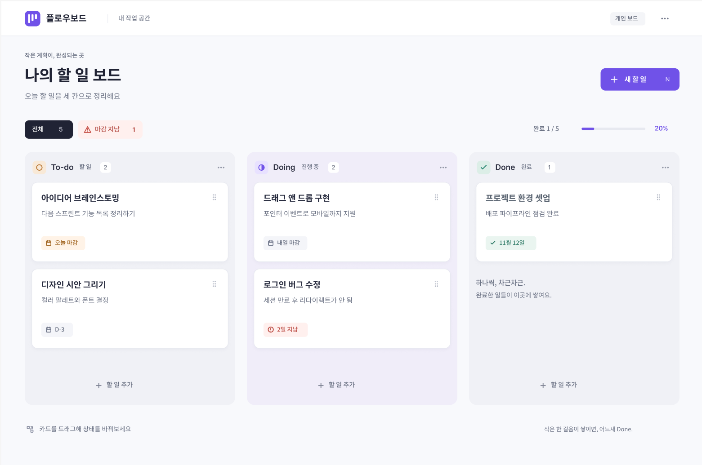

# 플로우보드 (FlowBoard)

작은 계획이, 완성되는 곳 — 순수 클라이언트 사이드로 동작하는 칸반/투두 보드입니다. 백엔드 없이 브라우저의 `localStorage`에 상태를 저장합니다.



## 주요 기능

- To-do / Doing / Done 3단 칸반 보드
- 포인터 이벤트 기반 드래그 앤 드롭 (마우스/터치 모두 지원)
- 마감일 표시 및 상태 뱃지 (지남 / 오늘·내일 마감 / D-day)
- "마감 지남" 필터, 진행률(완료 비율) 표시
- 카드 추가 / 수정 / 삭제 모달
- 컬럼 비우기, 키보드 단축키(`N`: 새 할일, `Esc`: 모달 닫기)

## 시작하기

```bash
npm install
npm run dev       # http://localhost:5173
```

## 스크립트

| 명령 | 설명 |
| --- | --- |
| `npm run dev` | Vite 개발 서버 실행 |
| `npm run build` | `dist/`로 프로덕션 빌드 |
| `npm run preview` | 프로덕션 빌드 로컬 서빙 |
| `npm run lint` | ESLint 검사 |
| `npm test` | Vitest 전체 테스트 실행 |

## 기술 스택

Vite + Vanilla JS (프레임워크 없음). 라우팅/백엔드 없이 `index.html` 하나가 `src/main.js`를 모듈로 로드하는 단일 페이지 구조입니다.

## 프로젝트 구조

```
index.html          # 마크업
src/style.css        # 전체 스타일 (다크모드 지원)
src/main.js          # 앱 로직 (상태, 렌더링, 드래그앤드롭, 모달)
src/lib/date.js       # 순수 날짜 유틸 (테스트 대상)
tests/date.test.js    # src/lib/date.js 유닛 테스트
sample/*.png          # 원본 Claude Artifact 디자인 참고 스크린샷
```

자세한 아키텍처 설명은 [`CLAUDE.md`](./CLAUDE.md)를 참고하세요.
